# Rumo

A self-hosted personal budgeting app that adapts to how you bank. One account and a plain monthly plan by default; switch on a monthly transfer between two accounts and/or a shared household account when your life needs them. Python standard library only, one SQLite file, no build step.

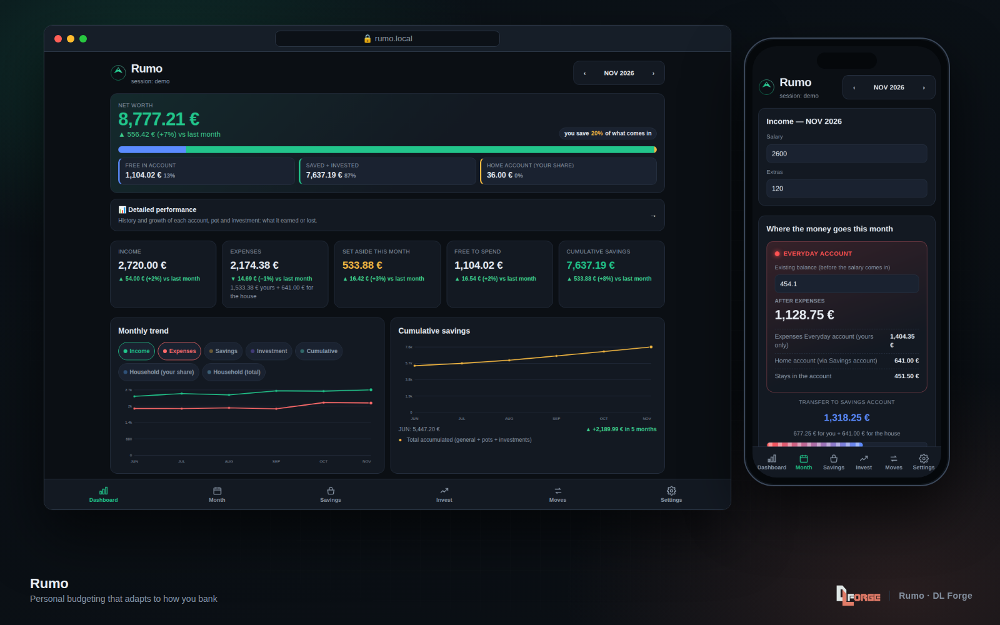

> The interface is in **English by default**. Switch to European Portuguese (pt-PT) in **Settings → Language**; the choice is stored with your data. [Leia em português](README.pt-PT.md).

## What it does

- **Monthly plan.** Income, planned expenses by category, and what is left. Every expense line can be searched by name, amount or account (`/` focuses the search box).
- **Accounts that fit you.** Defaults to **one account**. Optional schemes, off until you enable them in Settings:
  - **Two accounts with a monthly transfer:** the money left after expenses moves in part (a % or an amount) from your main account to a second one, from which savings are taken.
  - **Shared household account:** expenses split with a partner by a fixed share or by income; your share, your partner's share and the running balance of the shared account.
  - Account names are yours to choose. See [Options](#options-accounts-currency-savings).
- **Savings split.** A monthly savings rate divided into a general reserve, targeted pots (with goals and dates) and investments. The split **balances itself to 100%**: pick which one absorbs the difference; if what you type no longer fits, it is clamped to the maximum possible and you are told. Double-click (double-tap or long-press on touch) an amount to type it instead of a percentage.
- **Percentage or amount, your choice.** Transfer and savings rates take either; the other follows.
- **Dashboard.** Net worth with its composition, savings rate, trends, spending by category and where the money sits. Every card, slice and bar explains itself on hover or tap.
- **Pots that earn interest.** Each pot is *fixed* (kept as it is), *variable* (spent over time) or a *goal* (saved up by a date). Add a gross annual rate (TANB, with an optional tax rate) or a fixed monthly amount; Rumo forecasts the interest and brings the goal date forward accordingly.
- **Real versus expected.** Every month you can type the **real balance at the end of last month** of any pot, investment, the general reserve or the joint account. Rumo compares it with what it expected (opening balance plus what you set aside) and keeps the difference: what the money earned or lost.
- **Detailed performance.** A drawer on the dashboard with the history and growth of every account, pot and investment: capital over time, expected against real, best and worst months, forecast with interest, and a short reading that depends on the pot type (fixed, variable, goal) or the investment type (crypto, stocks, goods, automatic).
- **Investments.** Positions with live prices (Yahoo Finance, unofficial and delayed) or manual values. The positions list has category tabs with totals, search, sorting and pages, and a switch to a **totals-by-category** view. The dashboard panel shows the trend, allocation, target against real, the biggest risers and fallers (since purchase or today), contributions against market gains, concentration, currency exposure and a plain-language reading.
- **Any currency.** Set your currency in Settings; positions in other currencies are converted into it.
- **Optional AI advice** with your own key (Anthropic, OpenAI, Gemini or DeepSeek). Nothing leaves your server unless you ask.
- **Step-by-step transfers.** A checklist of what to move this month.
- **Responsive**, can be added to a phone's home screen, light on dependencies: Python 3.10+ and a browser.

| | |
|---|---|
| 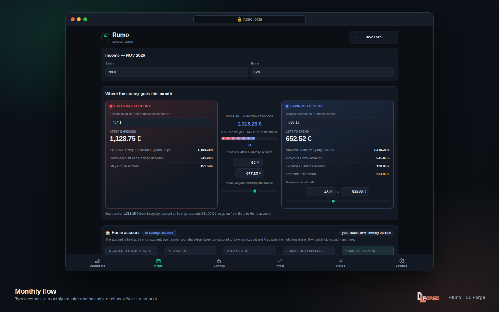 | 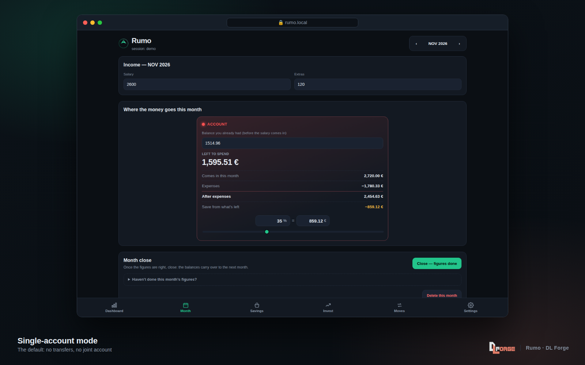 |
| 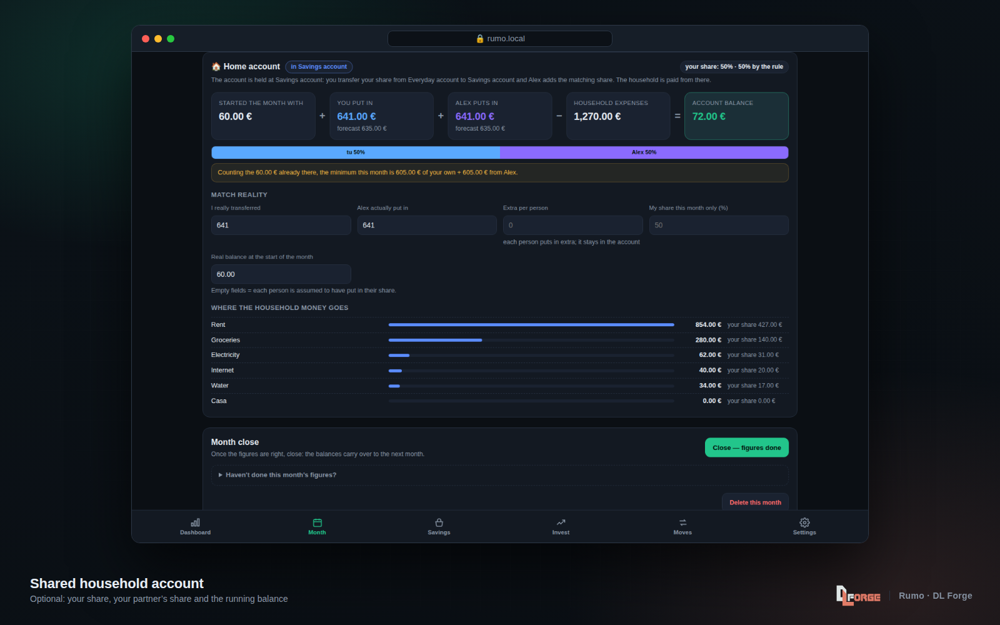 | 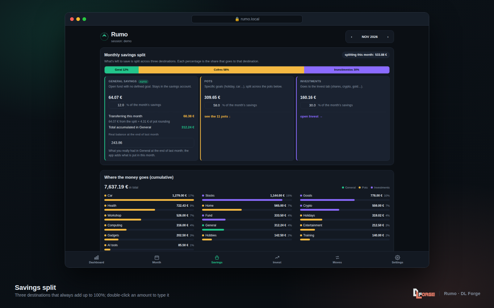 |
| 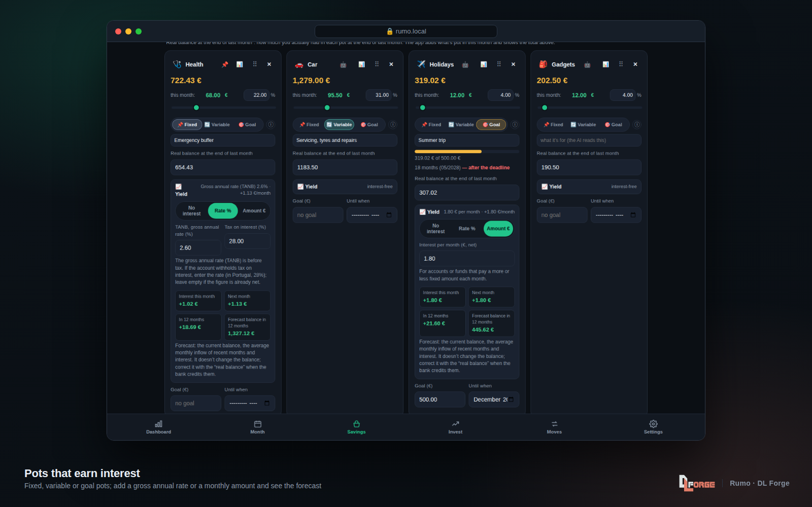 | 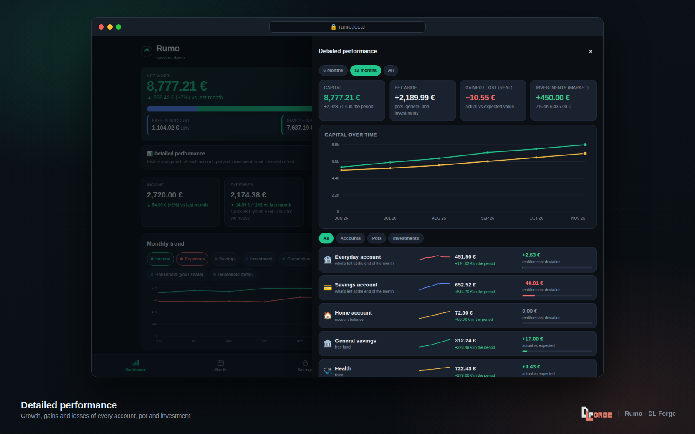 |
| 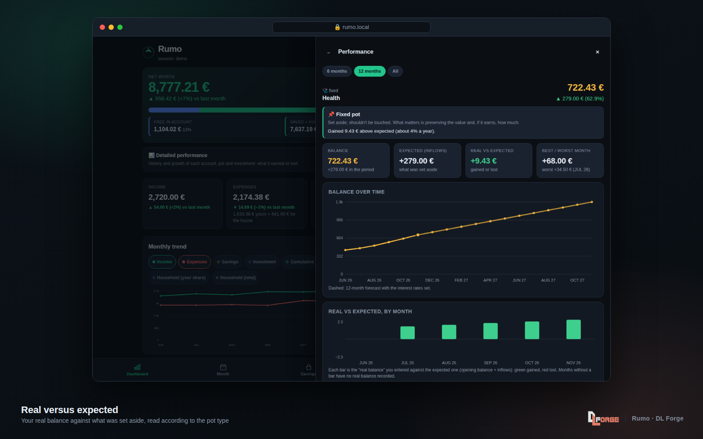 | 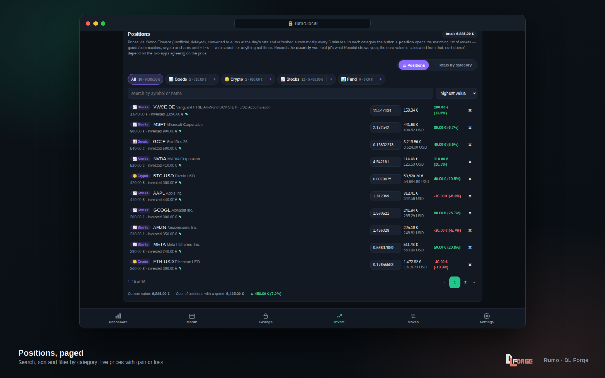 |
| 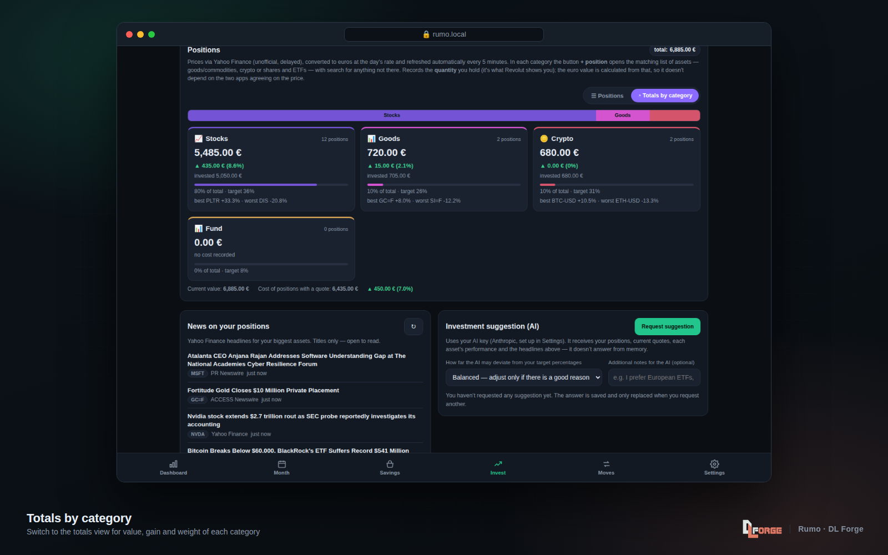 | 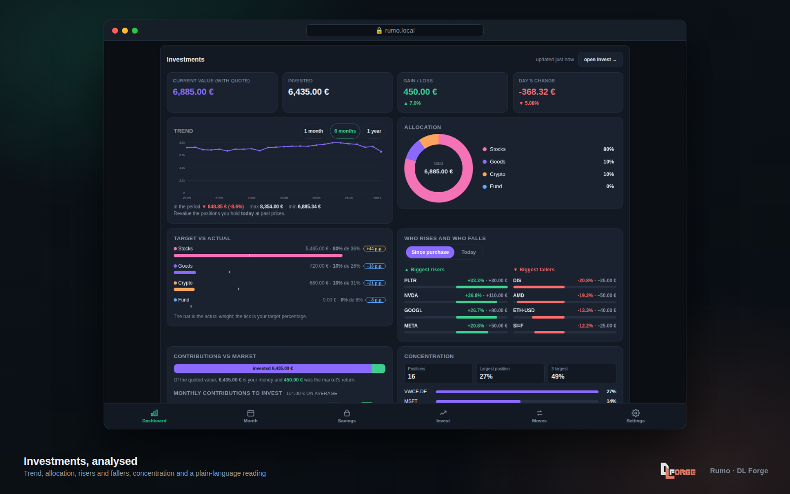 |
| 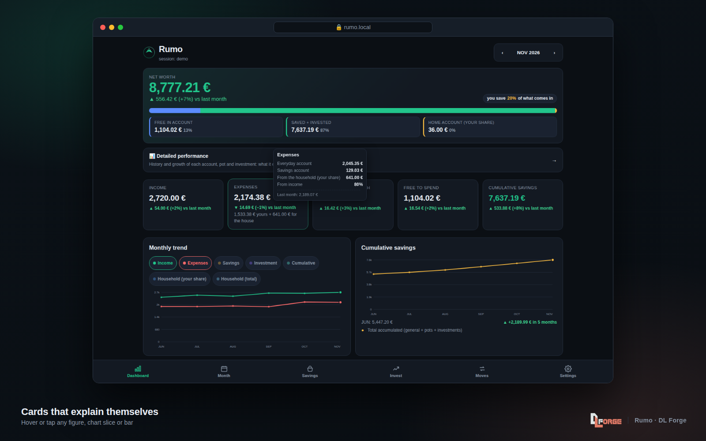 | 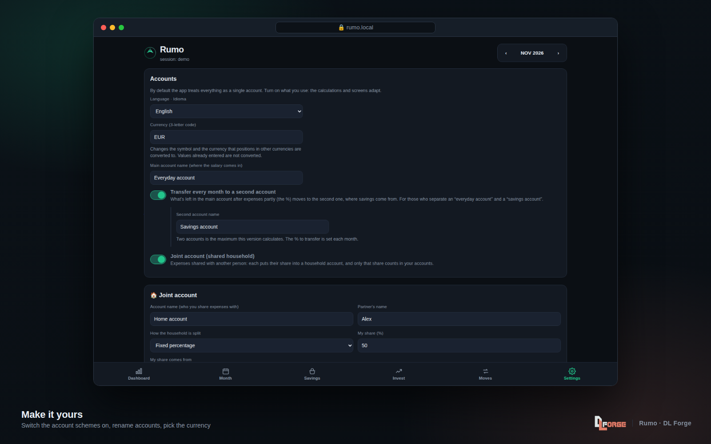 |

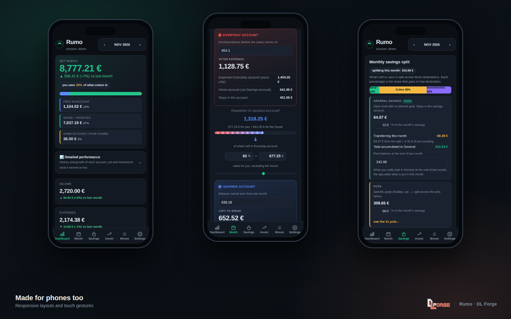

*Screens show invented sample data.*

## Run

```bash
git clone https://github.com/hubertdungen/Rumo.git
cd Rumo
python3 server.py            # http://127.0.0.1:8099
```

On first visit, create your user. Data lives in `~/.local/share/rumo/rumo.db` (override with `--data-dir` or `RUMO_DATA_DIR`). To start from scratch, delete that file.

`seed.json` provides a starter catalogue of expense lines, pots and investment categories (in English). Edit them in the app. An existing database created before the language option keeps Portuguese.

### Behind a reverse proxy (recommended for anything beyond localhost)

Rumo speaks plain HTTP. If you expose it, put it behind a TLS terminating proxy (Caddy, nginx, Cloudflare Tunnel…) and set `RUMO_COOKIE_SECURE=1`. When the proxy runs on the same host or LAN, `X-Forwarded-For` / `CF-Connecting-IP` are trusted automatically; add other proxy networks to `RUMO_TRUSTED_PROXIES`. Ask the proxy to add `X-Frame-Options: DENY` if the app should never be framed.

## Options: accounts, currency, savings

Everything is in **Settings**:

| Option | Default | Effect |
|---|---|---|
| Language | English | English or European Portuguese (pt-PT). Stored with your data and applied on every device. |
| Currency | EUR | Symbol and the currency that positions in other currencies convert to. Existing amounts are not converted. |
| Name of the main account | Account | Used everywhere. |
| Transfer to a second account every month | off | Adds the second account, the transfer slider (% or amount) and the second balance to the month, dashboard and transfer checklist. With it off, everything is treated as one account. |
| Shared household account | off | Adds the shared-account card, the "shared" choice on each expense line and the household series in charts. Name, partner and how the household is split are editable. |
| Balance the savings split to 100% automatically | on | Pick which share (general, pots or investments) takes the difference. |
| Rounding of pots and investments | on | Rounds each pot down to €0.50 steps and moves the leftover to the general reserve. |

Two accounts is the maximum this version calculates; the transfer percentage is set per month. A database created before these options existed keeps both schemes on and stays in Portuguese, so upgrading changes nothing.

## Configuration

Environment variables (all optional):

| Variable | Default | |
|---|---|---|
| `RUMO_HOST` / `RUMO_PORT` | `127.0.0.1` / `8099` | Bind address and port. |
| `RUMO_DATA_DIR` | `~/.local/share/rumo` | Folder holding `rumo.db`. |
| `RUMO_ALLOW_SIGNUP` | off | Allow more users to register after the first one. Read the note on single-user below first. |
| `RUMO_ALLOW_PUBLIC_BOOTSTRAP` | off | By default only a LAN/loopback client can create the first user. |
| `RUMO_COOKIE_SECURE` | off | Mark the session cookie `Secure` (use behind HTTPS). |
| `RUMO_TRUSTED_PROXIES` | | Extra CIDR ranges whose forwarded-IP headers are believed. |
| `RUMO_LOGIN_MAX_FAILS` | `6` | Failed logins per 15 minutes before a lockout, per address and per username. |
| `RUMO_PBKDF2_ROUNDS` | `600000` | Password hashing cost. |
| `RUMO_SESSION_DAYS` | `30` | Session lifetime. |
| `RUMO_ANTHROPIC_MODEL`, `RUMO_OPENAI_MODEL`, `RUMO_GEMINI_MODEL`, `RUMO_DEEPSEEK_MODEL` | | Models used for AI advice. |
| `RUMO_PRICE_TTL`, `RUMO_HISTORY_TTL`, `RUMO_NEWS_TTL` | | Cache lifetimes for market data. |
| `GIRO_DB_PATH`, `GIRO_DATA_DIR`, `FATIA_DB_PATH` | | Optional companion apps, below. |

AI keys are entered in Settings and stored in the database (never returned to the browser or included in the export). Treat `rumo.db` and its backups as sensitive.

## Optional companion apps

Rumo reads other SQLite databases **only if they exist**; without them nothing changes.

- **[Fatia](https://github.com/hubertdungen/Fatia)** (3D print quotes): jobs marked as printed this month are added to income. Set `FATIA_DB_PATH`.
- **Giro** (a debt tracker, not published): its instalments appear as locked expense lines. Set `GIRO_DB_PATH` or `GIRO_DATA_DIR`. If the file does not exist the integration is inactive.

## Security notes

- Built for **one person or one household**: every user shares the same data (there is no per-user isolation). Registration is therefore closed after the first user; keep it closed unless the people you add should see everything.
- Passwords use PBKDF2-HMAC-SHA256; sessions are random tokens stored hashed, `HttpOnly` and `SameSite=Lax`. Logins are rate limited. State-changing requests must be JSON and, when sent by a browser, from the same origin.
- It binds to `127.0.0.1` by default. Static files are served from an allow-list (the app shell, its script and icons), never source, tests, seed or the database.
- The CSP permits inline scripts and styles (the app is a single page). There is no telemetry.
- Market data and AI calls go to Yahoo Finance and the provider you choose, and only when you use those features.

Found something? Please open a private security advisory on GitHub.

## Tests

```bash
for t in test_*.py; do python3 "$t" || break; done   # server logic
node test_emoji.js                                    # emoji matching
```

## Licence

MIT, free for personal and commercial use, see [LICENSE](LICENSE). Part of [DL Forge](https://dlforge.dungenlabs.com/), the DungenLabs software division.
