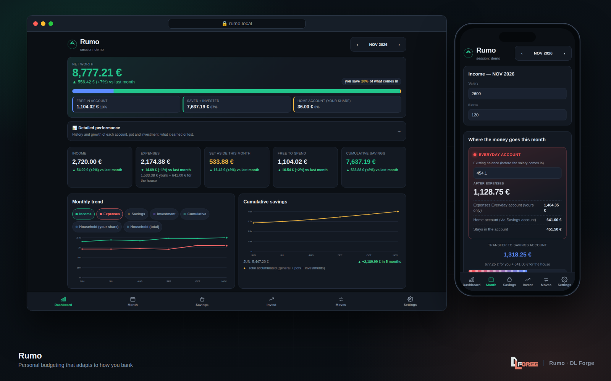

# Rumo

Uma app de orçamento pessoal que podes alojar tu, e que se adapta à maneira como usas o banco. Por omissão: uma conta e um plano mensal simples; liga a transferência mensal entre duas contas e/ou uma conta conjunta da casa quando a tua vida o pedir. Só biblioteca-padrão do Python, um único ficheiro SQLite, sem passo de compilação.



## O que faz

- **Plano do mês.** Rendimento, despesas previstas por categoria e o que sobra. Qualquer linha se procura por nome, valor ou conta (a tecla `/` põe o cursor na pesquisa).
- **Contas à tua medida.** Por omissão, **uma conta**. Esquemas opcionais, desligados até os ligares nas Definições:
  - **Duas contas com transferência mensal:** o que sobra da conta principal depois das despesas passa em parte (em % ou em valor) para uma segunda, de onde sai a poupança.
  - **Conta conjunta da casa:** despesas divididas com outra pessoa, por uma parte fixa ou pelos ordenados; a tua parte, a da outra pessoa e o saldo da conta.
  - Os nomes das contas são os que escolheres.
- **Divisão da poupança.** Uma taxa de poupança mensal repartida por reserva geral, cofres com objetivo e investimentos. A divisão **ajusta-se sozinha a 100%**: escolhes qual absorve a diferença; se o que escreves já não cabe, fica no máximo possível e a app avisa. Duplo clique (toque duplo ou premir, no telemóvel) num valor permite escrevê-lo em vez da percentagem.
- **Percentagem ou valor, como preferires.** A taxa de transferência e a de poupança aceitam as duas; a outra acompanha.
- **Dashboard.** Património e a sua composição, taxa de poupança, tendências, despesas por categoria e onde está o dinheiro. Cada cartão, fatia e barra explica-se ao passar o rato ou tocar.
- **Cofres que rendem juros.** Cada cofre é *fixo* (guardado), *variável* (gasta-se ao longo do tempo) ou *objetivo* (juntar até uma data). Junta uma TANB (com taxa de imposto opcional) ou um valor mensal fixo; o Rumo prevê os juros e antecipa a data do objetivo.
- **Real contra esperado.** Todos os meses podes escrever o **valor real no fim do mês anterior** de qualquer cofre, investimento, da reserva geral ou da conta conjunta. O Rumo compara-o com o que esperava (saldo de abertura mais o que puseste de parte) e guarda a diferença: o que o dinheiro rendeu ou perdeu.
- **Desempenho detalhado.** Uma gaveta no dashboard com o histórico e o crescimento de cada conta, cofre e investimento: capital ao longo do tempo, esperado contra real, melhores e piores meses, previsão com juros e uma leitura que depende do tipo de cofre (fixo, variável, objetivo) ou de investimento (cripto, ações, bens, automático).
- **Investimentos.** Posições com preços em direto (Yahoo Finance, não oficial e com atraso) ou valor manual. A lista de posições tem separadores por categoria com totais, pesquisa, ordenação e páginas, e uma vista de **totais por categoria**. No dashboard: evolução, alocação, alvo contra real, o que mais sobe e desce (desde a compra ou hoje), entradas contra ganhos de mercado, concentração, moedas e uma leitura em frases.
- **Qualquer moeda.** Define a moeda nas Definições; posições noutras moedas convertem-se para ela.
- **Conselhos de IA opcionais** com a tua chave (Anthropic, OpenAI, Gemini ou DeepSeek). Nada sai do servidor sem o pedires.
- **Movimentos passo a passo.** Uma lista do que transferir este mês.
- **Responsiva**, pode ir para o ecrã inicial do telemóvel; precisa só de Python 3.10+ e de um navegador.

A app vem em **inglês por omissão**; muda para português europeu em **Definições → Idioma** (fica guardado com os teus dados). Os ecrãs mostram dados de exemplo inventados (ver as imagens no [README em inglês](README.md)).

## Correr

```bash
git clone https://github.com/hubertdungen/Rumo.git
cd Rumo
python3 server.py            # http://127.0.0.1:8099
```

Na primeira visita, cria o teu utilizador. Os dados ficam em `~/.local/share/rumo/rumo.db` (muda com `--data-dir` ou `RUMO_DATA_DIR`). Para recomeçar do zero, apaga esse ficheiro. O `seed.json` dá um catálogo inicial de linhas de despesa, cofres e categorias de investimento, que editas na app (em inglês; uma base de dados anterior à opção de idioma fica em português).

Para além do `localhost`, põe a app atrás de um proxy com HTTPS (Caddy, nginx, Cloudflare Tunnel…) e define `RUMO_COOKIE_SECURE=1`.

## Opções (Definições)

| Opção | Por omissão | Efeito |
|---|---|---|
| Idioma | Inglês | Inglês ou português europeu (pt-PT). Guarda-se com os dados e vale em todos os aparelhos. |
| Moeda | EUR | Símbolo e moeda para onde se convertem as posições noutras moedas. Os valores já escritos não se convertem. |
| Nome da conta principal | Account | Usado em todo o lado. |
| Transferir todos os meses para uma segunda conta | desligado | Junta a segunda conta, o controlo da transferência (% ou valor) e o segundo saldo ao mês, ao dashboard e aos movimentos. Desligado, tudo é uma só conta. |
| Conta conjunta | desligado | Junta o cartão da conta conjunta, a escolha «da casa» em cada despesa e as séries da casa nos gráficos. |
| Ajustar a divisão da poupança a 100% | ligado | Escolhes que parte (geral, cofres ou investimentos) fica com a diferença. |
| Arredondamento de cofres e investimentos | ligado | Arredonda cada cofre para baixo, em passos de 0,50 €, e passa a sobra para a reserva geral. |

Duas contas é o máximo que esta versão calcula. Uma base de dados anterior a estas opções fica com os dois esquemas ligados, e em português, por isso atualizar não muda nada.

## Segurança

Feita para **uma pessoa ou uma casa**: todos os utilizadores partilham os mesmos dados (não há isolamento por utilizador), por isso o registo fecha depois do primeiro. Escuta em `127.0.0.1` por omissão, as palavras-passe usam PBKDF2-HMAC-SHA256, as sessões são tokens aleatórios guardados com hash, e o login tem limite de tentativas. Os ficheiros estáticos servem-se de uma lista permitida. As chaves de IA ficam na base de dados (nunca vão para o navegador nem para a exportação): trata `rumo.db` e as cópias como sensíveis. Há mais detalhe, e a lista das variáveis de ambiente, no [README em inglês](README.md).

## Licença

MIT, livre para uso pessoal e comercial, ver [LICENSE](LICENSE). Faz parte do [DL Forge](https://dlforge.dungenlabs.com/), a divisão de software da DungenLabs.
